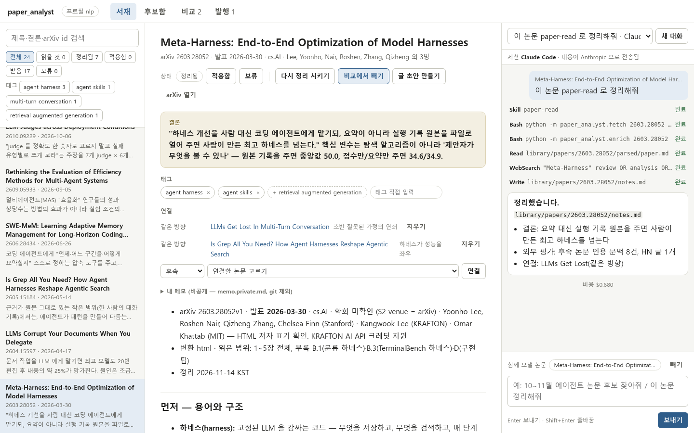
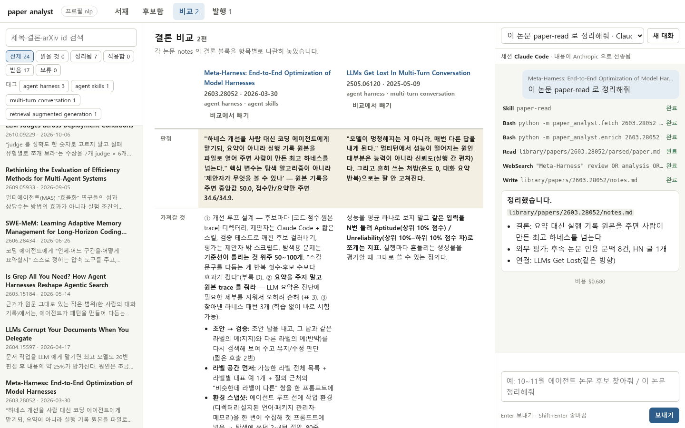
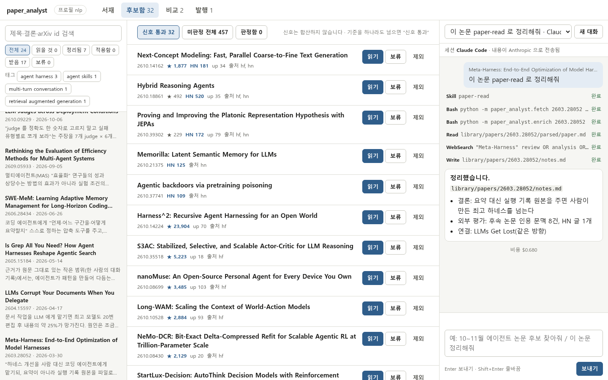
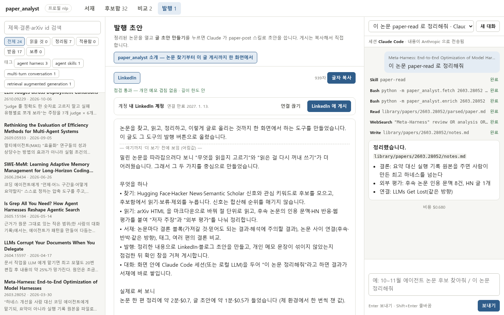

# paper_analyst — 논문을 찾아 읽고, 외부 평가를 붙여 실무 관점의 결론을 낸다

논문 후보를 찾고(HF·HN·Semantic Scholar), 받아서 마크다운으로 바꾼 뒤, **Claude(Claude Code)가 읽고 정리**한다.
세 가지로 쓴다: **화면**(서재 + 후보함 + Claude 대화) · **Claude Code 스킬**(터미널) · **import**(파이썬 엔진).
분야는 프로필(`profiles/*.toml`)로 바꾼다. PDF 를 Claude 에 직접 넣지 않는다 — 변환된 md 만 절 단위로 읽는다 (토큰).
범위: 후보 소스와 받기가 arXiv 기반이라 **arXiv 에 올라오는 분야**에서 동작한다.

## 화면


서재: 왼쪽 목록(상태·태그로 거르기) · 가운데 논문(결론 블록 → 태그 → 연결 → notes) · 오른쪽 Claude 대화 (도구 실행이 줄로 보임)

| 결론 비교 | 후보함 |
|---|---|
|  |  |
| 담은 논문들의 결론을 항목별로 나란히 | 신호(★·HN·인용·키워드)로 모은 후보를 읽기·보류·제외 |


발행: 초안을 LinkedIn 글자 / 블로그 마크다운 / 티스토리 HTML 로 보고 복사하거나, 확인 창을 거쳐 LinkedIn 에 게시

(캡처는 `python tools/screenshots.py` — 실제 서재의 공개 파일만 복사해 찍는다. 대화 패널은 예시 대화)

## 처음 쓰는 사람

```bash
git clone <this repo> && cd paper_analyst
pip install -e .                       # Python 3.11+ (또는 pip install -r requirements.txt)
claude                                 # Claude Code 설치·로그인 (스킬과 화면의 대화 세션이 쓴다)
```
1. **프로필 만들기** — Claude Code 에서 "세팅해줘" → `paper-setup` 스킬이 관심 분야·읽는 목적·**좋았던/안 맞았던 논문 몇 편**을 묻고,
   그 논문들이 필터에 잡히는지 시험해 `profiles/<이름>.toml` 을 만든 뒤 현재 프로필로 지정한다 (`profiles/active`, git 제외).
   직무 같은 개인 맥락은 `profiles/<이름>.private.md` 로 (git 제외). 예시: `profiles/nlp.toml` (NLP·LLM 응용, 실무 관점)
2. **화면 띄우기** — `python -m paper_analyst serve` → http://127.0.0.1:8768
3. 대화창에서 "10~11월 에이전트 논문 후보 찾아줘" → 후보함에서 읽기·보류·제외 → 논문을 열고 "Claude 에게 정리 시키기"
   → 정리가 끝나면 서재에 결론이 쌓인다

## 화면 (`python -m paper_analyst serve`, 127.0.0.1:8768)

| 영역 | 하는 일 |
|---|---|
| 서재 (왼쪽) | 논문을 상태별로 (읽을 것 · 정리됨 · 적용함 · 받음 · 보류), 결론 한 줄 미리보기, 검색, **태그로 거르기**. 목록·아이디어 문서 |
| 논문 (가운데) | 결론 블록 → **태그**(관심 주제 제안 + 직접 입력) → **연결**(후속·반박·같은 방향·관련, notes 에 나온 서재 논문을 제안) → **내 메모**(`memo.private.md`, git 제외) → notes 전문 → 개인 메모. 상태 바꾸기, "Claude 에게 정리 시키기", "비교에 담기" |
| 비교 (탭) | 담은 논문들의 결론 블록을 항목별(판정 · 가져갈 것 · 믿어도 되는 결과 · 해석에 주의할 결과 · 읽는다면)로 나란히 |
| 발행 (탭) | `paper-post` 스킬이 쓴 초안(`posts/`, git 제외)을 LinkedIn 글자 / 블로그 마크다운 / 티스토리 HTML 로 보고 복사. 개인 메모와 겹치는 줄·LinkedIn 길이를 경고 (게시는 직접) |
| 후보함 (탭) | discover 결과. 신호 통과 / 미판정 전체 / 판정함, 초록 펼치기, 읽기·보류·제외 (읽기 → 서재 '읽을 것') |
| 대화 (오른쪽) | 세션 2종 중 대화마다 하나. 보고 있는 논문을 함께 보낸다. 도구 실행이 줄로 보이고 중지할 수 있다 |

**대화 세션 2종**
- **Claude Code** — 서버가 이 폴더에서 `claude -p --output-format stream-json`(첫 턴 `--session-id`, 이후 `--resume`)을 실행한다.
  스킬·CLAUDE.md 가 그대로 적용되고, 결과 파일이 생기면 서재가 바로 갱신된다. **대화 내용이 Anthropic 으로 전송된다.**
  권한은 허용 목록만 (`paper_analyst/chat.py` `ALLOWED`): 도구 실행(`python -m paper_analyst.*`), 읽기·검색, 웹 검색,
  `library/`·`lists/`·`ideas/`·`profiles/`·`posts/` 쓰기. 그 밖은 거부되고 화면에 "거부" 로 보인다 (화면에서 승인하는 창구는 없다).
- **로컬 LLM** — vLLM(OpenAI 호환, 기본 `http://<호스트 IP>:8002/v1`, `PAPER_LLM_URL` 로 변경)의 Qwen. 서재 조회·notes 읽기·제목→id·
  후보 보기·받기 도구만 쓴다 (정리는 하지 않는다). 서버가 꺼져 있으면 선택지가 잠기고 켜는 법이 보인다.
- 대화·실행 기록·후보 판정·태그·연결은 `data/paper_analyst.db` (SQLite, git 제외) — 서버를 다시 켜도 같은 대화를 이어간다.
- **게시는 사람이 누를 때만.** LinkedIn 은 발행 탭의 "LinkedIn 에 게시"(확인 창 → 한 번만, 아래 설정 필요). 티스토리는 Open API 가 종료된 것으로 알아 (확인 안 함) HTML 을 복사해 붙여 넣는다. 예약·자동 게시는 없다.

## LinkedIn 게시 (선택)

공식 API 만 쓴다 ("Share on LinkedIn" + "Sign In with LinkedIn using OpenID Connect"). 처음 한 번:
1. LinkedIn 개발자 사이트에서 앱 만들기 — **LinkedIn 페이지 연결이 필수**다 (개인 프로필에만 올려도). 페이지 관리자가 연결을 승인한다
2. 앱의 Products 에서 **Share on LinkedIn**, **Sign In with LinkedIn using OpenID Connect** 추가
3. Auth 의 Redirect URL 에 `http://127.0.0.1:8768/api/linkedin/callback`
4. 키를 환경변수 `LINKEDIN_CLIENT_ID`·`LINKEDIN_CLIENT_SECRET` 또는 `data/linkedin_app.json` (`{"client_id": "...", "client_secret": "..."}`, git 제외) 에 두고 서버를 켠다
5. 발행 탭 → **LinkedIn 연결** → 로그인·승인 → 토큰은 `data/linkedin_token.json` (권한 600, git 제외)

- 게시: 발행 탭의 LinkedIn 보기에서 **LinkedIn 에 게시** → 확인 창(계정·글자 수) → 게시. 점검 경고(개인 메모 겹침·길이 초과)가 남으면 잠기고,
  미리보기 뒤 초안이 바뀌었으면 거부하며, 한 글은 한 번만 올린다. 게시 기록(글 링크·시각)은 초안의 `meta.json` 에
- 액세스 토큰은 60일, 갱신 토큰은 일부 파트너에게만 주어진다 → 만료되면 다시 연결 (공식 문서, 2026-11-15 확인)
- 화면의 Claude 세션에는 게시 권한이 없다 — 대화로 "올려줘"라고 해도 올라가지 않는다
- 범위: 글자·링크만 (이미지 첨부는 업로드 절차가 따로 있어 아직 없음)

## import (엔진)

```python
from paper_analyst import profile, discover, resolve, fetch, enrich, library, ROOT
prof = profile.load()                                   # 현재 프로필
resolve.resolve("Meta-Harness: End-to-End Optimization of Model Harnesses")   # ('확정', '2603.28052', …)
fetch.fetch_one("2603.28052", parse=True, via="auto", layout_url=None, force=False)
library.scan_papers(ROOT)                               # 서재 (파일 기준)
```
화면의 상태(후보 판정·대화)는 `paper_analyst.service.Service` 가 가진다 (`app.create_app` 이 이것만 부른다).

## Claude Code 스킬 (터미널)
- "10월에 주목받은 LLM 에이전트 논문 찾아줘" → **paper-find** / "2603.28052 정리해줘" → **paper-read** / "세팅해줘" → **paper-setup**
  / "이걸로 링크드인 글 써줘" → **paper-post** (초안만, 게시는 직접. `python -m paper_analyst.post check posts/<이름>` 으로 점검)
- 원문(PDF·HTML·변환 md)은 저장소에 없다 — `fetch` 로 각자 받는다. `notes.md` 는 논문 정리이고 `*.private.md` 는 git 에서 제외된다.

## 폴더

```
paper_analyst/
├── README.md · CLAUDE.md · pyproject.toml
├── .claude/skills/
│   ├── paper-setup/SKILL.md # 프로필 만들기: 인터뷰 → 초안 → 예시 논문으로 시험(--check) → 보정 → 지정
│   ├── paper-find/SKILL.md  # 읽을 논문 고르기 (discover → 초록 → 프로필 기준 판정 → lists/), 붙여넣은 목록은 resolve
│   ├── paper-read/SKILL.md  # 논문 읽고 notes.md 정리 (받기 → 외부 신호 → 절 단위 읽기 → 웹 검색 1회 → 대조 → 작성)
│   └── paper-post/SKILL.md  # notes·ideas → LinkedIn·블로그 초안 (posts/, 개인 메모 겹침 점검)
├── paper_analyst/           # 패키지 (import · python -m paper_analyst.<도구> · serve)
│   ├── profile.py           # 현재 프로필 찾기·요약·지정 (--use)
│   ├── discover.py          # 후보 찾기: HF·HN·S2 수집 → 기간·주제·신호 필터 (--check: 예시 논문 시험)
│   ├── resolve.py           # 논문 제목·링크 → arXiv id (정확 일치만 확정)
│   ├── fetch.py · arxiv_html.py   # arXiv 받기 + HTML → 마크다운
│   ├── enrich.py            # 외부 신호(S2 인용 문맥·HN·PWC·HF) → external.json
│   ├── library.py           # 서재 읽기 (파일 → 목록·결론·HTML)
│   ├── store.py · service.py      # 상태(SQLite) · 서비스 (화면 API 가 부르는 유일한 층)
│   ├── chat.py              # 대화 세션 2종 (Claude Code · 로컬 LLM)
│   ├── post.py              # 발행 초안 읽기·점검 (개인 메모 겹침·길이)
│   ├── linkedin.py          # LinkedIn 공식 API (OAuth·게시) — 화면 버튼으로만
│   └── app.py · __main__.py · static/index.html   # 제품 API · serve · 화면
├── profiles/                # nlp.toml (예시) · active (git 제외) · *.private.md (git 제외)
├── lists/ · ideas/          # 읽을 목록 · 논문에서 나온 논의·설계안
├── docs/SOURCES.md          # 어느 소스를 언제 쓰나 + 측정 근거
├── tests/test_api.py        # 제품 API 진입점 테스트 (모델·네트워크만 가짜)
├── tools/browser_check.py   # 실제 브라우저 점검 (실제 서재 복사본 + 가짜 세션)
├── tools/screenshots.py     # README 캡처 (docs/images/)
├── data/ · posts/           # (git 제외) 화면 상태 DB · 발행 초안
└── library/
    ├── papers/<arxiv_id>/   # meta.json · notes.md · (git 제외) paper.pdf · paper.html · parsed/ · external.json · notes.private.md
    └── candidates/          # (git 제외) discover 결과 <날짜>_<프로필>_<from>_<to>.jsonl
```

## 후보 찾기 (`paper_analyst/discover.py`, `paper_analyst/resolve.py`)

```bash
python -m paper_analyst.discover --profile profiles/nlp.toml --from 2026-09 --to 2026-11            # hf,hn,s2
python -m paper_analyst.discover --from 2026-10 --to 2026-11 --sources hf,hn                         # 최근 구간
python -m paper_analyst.resolve "Memory Tax: Dissecting the Net Value of Agent Memory" https://arxiv.org/abs/2605.15184
```
- 기간은 arXiv id 의 YYMM(발표 월) 기준. 주제 필터는 제목 + HF 키워드에 정규식. 신호(★·HN·인용)는 **합산하지 않고** 하나라도 기준을 넘으면 통과
- 실측 2026-11-15: 2026-10~11, hf+hn → 모은 890 → 기간·주제 442 → 신호 12 (19초). S2 1주제 → 30편 중 신호 5
- resolve 는 정규화한 제목이 정확히 같을 때만 `확정`, 단어 절반 이상 겹치면 `확인 필요`(후보 표시), 아니면 `못 찾음`

## 받기

```bash
python -m paper_analyst.fetch 2604.12374 https://arxiv.org/abs/2609.05933 --parse   # 기본: HTML → 없으면 PDF
python -m paper_analyst.fetch 2604.12374 --via pdf --layout-url http://<host>:8090   # PDF 경로 강제 (doc_parser 필요,
                                                                                     # 레이아웃 서버: doc_reader/doc_parser/tools/ocr.sh start)
python -m paper_analyst.fetch 2604.12374 --reparse      # 변환기 고친 뒤: 받아 둔 html/pdf 로 변환만 다시
```

- **변환 경로 `--via`**: `auto`(기본) = arXiv HTML → 없거나 본문이 아니면 PDF + doc_parser / `html` / `pdf`
- 입력: id · `arxiv.org/abs|pdf|html/…` URL(스킴 없어도) · 버전(`v2`). 같은 논문은 건너뜀, `--force` 로 다시 받기
- 변환은 `parsed.tmp/` 에 만들고 성공하면 `parsed/` 와 교체 — 실패해도 이전 결과가 남는다
- arXiv 요청 간격 3초(그림 파일 1초), 429·503 은 5초·15초 뒤 재시도. 실패한 입력은 폴더를 만들지 않고 끝에 모아 출력, 종료 코드 1
- 메타데이터: arXiv API(export.arxiv.org) → 막히면 논문 페이지(arxiv.org/abs)의 메타 태그로 (`meta.json` 의 `meta_source`).
  한 실행에서 API 가 한 번 실패하면 나머지는 바로 abs 페이지. 실측 2026-11-14: API 가 16편 연속 429·503 → abs 로 20편 전부 받음

### HTML 변환이 하는 일 (`arxiv_html.py`)
제목 → `#`~`#####` (번호 포함 "## 1 Introduction") / 수식 → `$LaTeX$`, `$$…$$` (alttext 원문) /
표 → 마크다운 표 (rowspan·colspan 펼침, 굵게 유지) / 그림 → `` + `> 캡션` (SVG 는 PNG 로 렌더링,
긴 변 1000px) / 각주 → 본문 안 `[fn: …]` / 코드 → ``` / 참고문헌 → 목록. 저자는 md 에 넣지 않음 (meta.json 에 있음).
경고: `.ltx_ERROR`(LaTeXML 변환 실패 매크로) 수, 파싱 안 된 수식 수 → meta.json `parsed.warnings`.

## 외부 신호 붙이기 (`paper_analyst/enrich.py`)

```bash
python -m paper_analyst.enrich 2604.12374 2505.06120          # fetch.py 로 받아 둔 논문만
python -m paper_analyst.enrich 2604.12374 --refresh           # 7일 캐시 무시
```

- S2 는 키 없이도 쓸 수 있다 (429 가 잦음). 키가 있으면 `S2_API_KEY` 환경변수로 쓰인다
- **발표 90일 미만 논문은 S2 를 조회하지 않는다** (인용이 아직 없음 — 호출·429 만 늘림). 90일이 지나면 캐시 만료 후 조회

→ `library/papers/<id>/external.json` 전체 저장, 화면에는 Claude 가 읽을 요약만 (논문당 약 1~2k자).

| 소스 | 가져오는 것 |
|---|---|
| Semantic Scholar | 인용·영향력 인용·학회, **인용 문맥** (다른 논문이 이 논문을 인용한 문장, 영향력 있는 것 먼저 8건) |
| Hacker News | arXiv/HF 링크를 건 글 + 이름(제목 콜론 앞, 2단어 이상)이 구절 그대로 들어간 글, 댓글 있으면 상위 4개 |
| paperswithcode.co | tasks · methods · 벤치마크 순위 · 공식 코드 (비공개 API) |
| HF Papers | upvote · GitHub |

- 웹 검색(블로그·비판 글)은 하지 않음 — 읽는 쪽(Claude)이 논문당 1회
- 캐시 7일. **실패한 소스만 다음 실행 때 다시 조회** (429 를 7일 붙잡지 않음). 한 실행에서 S2 가 재시도 끝에
  429 면 나머지 논문은 S2 건너뜀
- 실측: S2 는 키 없이 429 가 잦다 (이 날 4편 중 1~3편 실패, 재실행으로 채움). 인용이 아주 많은 고전(Attention)은
  인용 문맥이 0건으로 온다 (오류 아님)
- HN 잡음 거르기: `explainarxiv.org/…/1706.03762` 같은 남의 서비스 URL 제외, 'Nemotron 3.5 Super' 는
  'Nemotron 3 Super' 로 안 잡음

## 실측 (2026-11-14)

| 논문 | 쪽 | 경로 | md 글자 | md 토큰(≈글자/4) | 그림 |
|---|---|---|---|---|---|
| Attention Is All You Need (2017) | 15 | HTML | 40,090 | ≈ 10k | 8 (SVG 5 → PNG) |
| Nemotron 3 Super (1단) | 51 | HTML | 157,107 | ≈ 39k | 20 |
| Rethinking MAS Eval (EMNLP, 2단) | 43 | HTML | 158,523 | ≈ 40k | 2 |
| SWE-MeM (2단) | — | HTML | 96,061 | ≈ 24k | 6 |

- 같은 논문 PDF 경로: Rethinking 153,723자·그림 5 / SWE-MeM 145,414자·그림 9 (2단 줄 섞임 있음)
- 토큰은 글자/4 어림 (토크나이저로 세지 않음). 부록·참고문헌 포함 전체 — 절 단위로 읽으면 훨씬 적다
- HTML 있는지 확인한 논문: 위 4편 + DeepSeek-V4, Kimi K3, ERNIE 5.0, Gemma 4, BERT, GPT-4, InstructGPT, 0704.0001(2007)
  → **전부 있음**. HTML 없는 논문은 아직 못 찾음 (PDF 경로는 `--via pdf` 와 캐시 HTML 손상으로 검증)
- 확인한 부정 케이스: 같은 id 2회 / 재실행 skip / 형식 오류 id / 없는 id(폴더 안 생김) / 스킴 없는 URL /
  버전 URL / HTML 이 본문 아님 → auto 는 PDF 로, `--via html` 은 실패 + 이전 결과 보존 / pdf↔html 전환 시 산출물 안 섞임

## 알려진 문제

- **PDF 경로의 2단 편집은 읽기 순서가 섞인다** (좌우 단 줄이 번갈아 붙음). arXiv 논문은 HTML 로 피한다.
  PDF 만 있는 논문(ACL Anthology 등)의 읽기 순서는 **doc_reader(doc_parser) 쪽 과제**다 — 이 저장소에서는 고치지 않는다.
- HTML: 제목 아래 라이선스 문구·처리 안 된 매크로 한 줄이 남는 논문이 있다 (Attention, SWE-MeM). 표 캡션은 표 뒤에 온다.
- HTML 그림 중 같은 파일을 두 번 참조하는 경우가 있다 (Nemotron: 링크 26, 파일 20).

## 라이선스

- **코드** (`paper_analyst/`, `tools/`, `tests/`, `.claude/skills/`, 설정 파일): [Apache License 2.0](LICENSE)
- **글** (`library/papers/*/notes.md`, `ideas/`, `lists/`, `docs/`): [CC BY 4.0](https://creativecommons.org/licenses/by/4.0/) — 출처를 밝히면 자유롭게 쓸 수 있다.
  논문 내용의 저작권은 각 논문 저자에게 있다. 원문(PDF·HTML·변환 md)은 이 저장소에 없다.
- 의존성 주의: SVG 그림 변환에 쓰는 **PyMuPDF 는 AGPL-3.0** (또는 상용 라이선스)이다. 선택 설치이며, 함께 배포하거나 서비스로 운영할 때는
  그 조건을 따른다. 없으면 SVG 그림만 빠지고 나머지는 동작한다.

